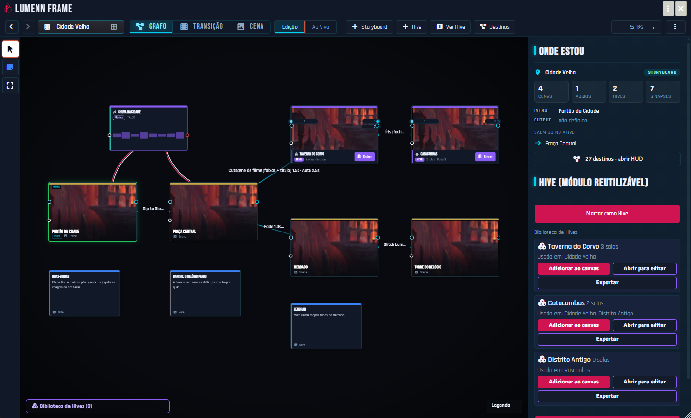
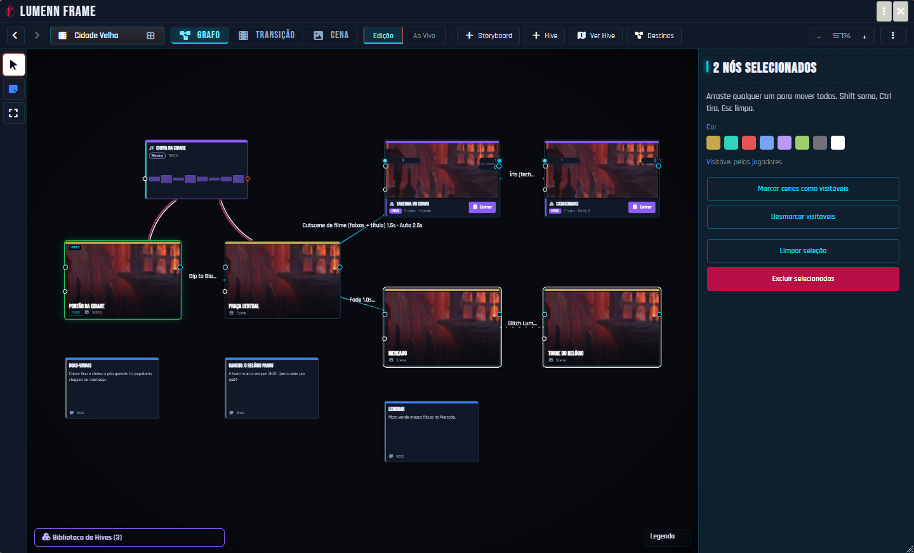
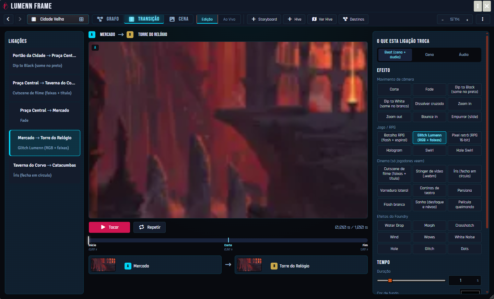
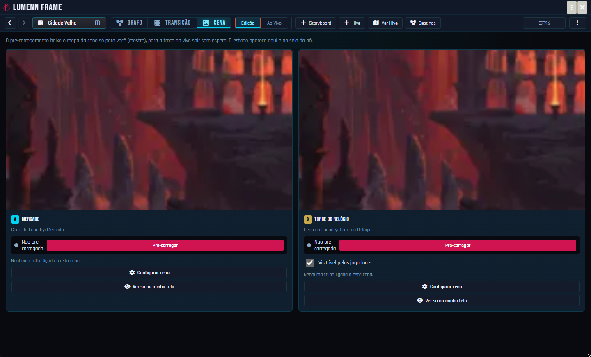
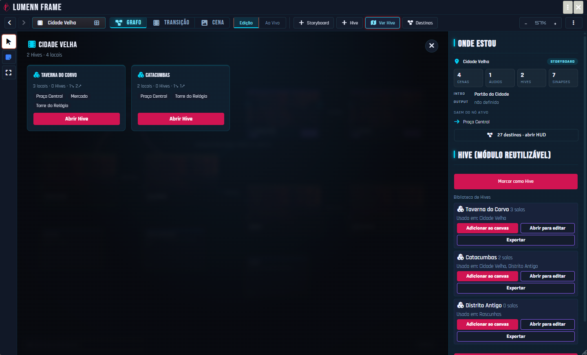
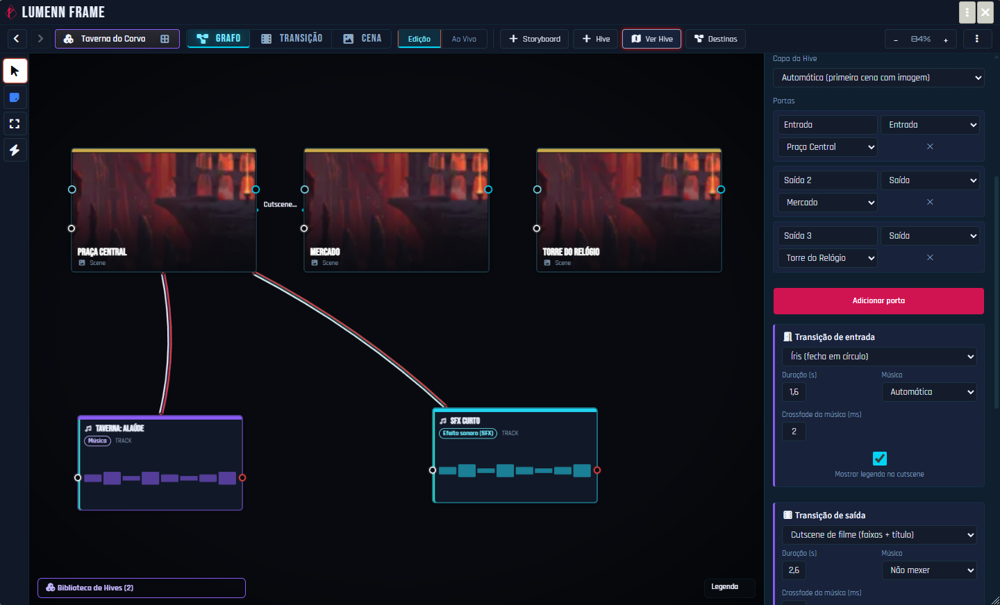
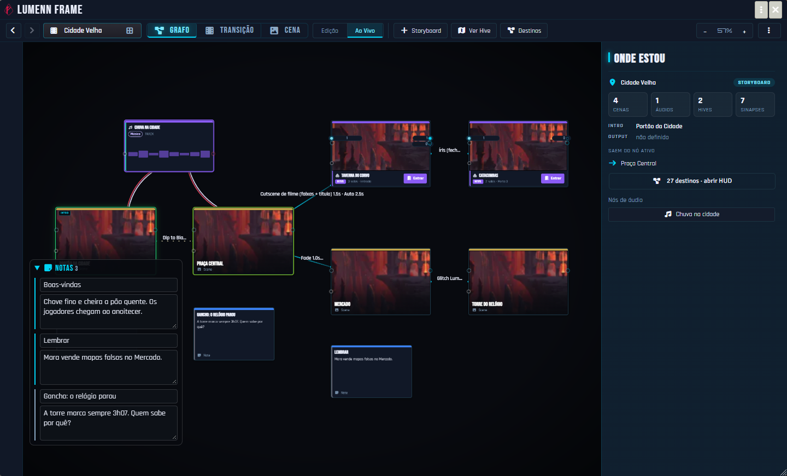
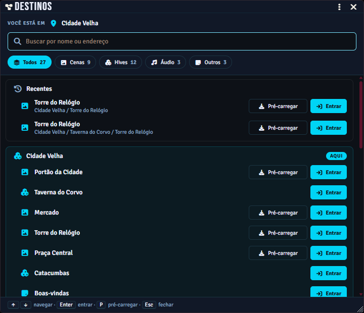
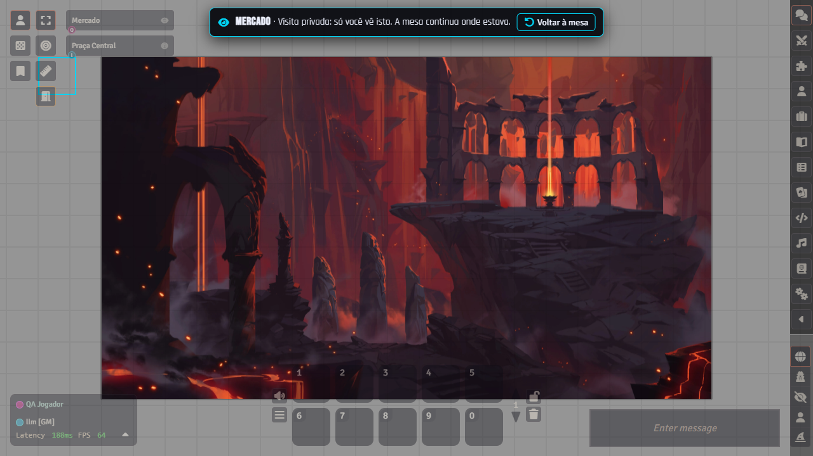

# Lumenn Frame

[](https://github.com/SoftMissT/Lumenn-Frame/releases/latest)
[](#compatibilidade)
[](LICENSE)

<p align="center">
  
</p>

**Português** · [English](#english)

---

## O que é

O Lumenn Frame é um **editor de storyboard para o Foundry VTT**. Antes da
sessão, você monta num quadro visual o caminho que a história pode seguir:
quais cenas existem, que música toca em cada uma e como se passa de uma para
outra. Na hora do jogo, você clica na próxima cena e o módulo faz a troca com a
transição e o áudio que já deixou prontos.

**É para quem:** mestres (GM) que querem sessões fluidas e cinematográficas,
sem caçar arquivos enquanto a mesa espera.

**O que vem no módulo:**

- editor de grafo com cenas, áudio, notas e **Hives** (lugares dentro de lugares);
- **estúdio de transição**, com prévia da troca entre a cena atual e a próxima;
- transições do Foundry, efeitos próprios, efeitos de cinema e **6 stingers de vídeo**;
- compêndio **Lumenn Frame: Transições**, com 19 transições prontas;
- modo **Ao Vivo** com salto direto, HUD de destinos e pré-carregamento.

## Como funciona em 30 segundos

Você desenha um **grafo**: caixas (nós) ligadas por linhas.

```text
 [Música: Fogueira] ──AUDIO──▶ [Cena: Acampamento] ══FLOW══ [Cena: Floresta]
                                                 (Dissolver 1.0s · Auto 3.0s)
```

- **Nós** são as peças: uma **Cena** do Foundry, um **Áudio** (playlist ou
  faixa), uma **Nota** sua ou uma **Hive** (um storyboard dentro de outro).
- **FLOW** é o caminho da história. Uma ligação **vale nos dois sentidos**: ligar
  A → B já permite voltar de B para A, com a mesma transição.
- **AUDIO** liga um áudio a uma cena. Esse tem mão única.
- Dois modos: **Edição** (você monta) e **Ao Vivo** (você joga e navega).

## Conheça a tela



*O editor em modo Edição, com uma campanha de exemplo: uma cidade, uma taverna e
umas catacumbas. As imagens deste guia mostram a interface em português.*

1. **Topo, à esquerda:** o seletor de storyboards e as abas **Grafo ·
   Transição · Cena**.
2. **Topo, no meio:** **Edição / Ao Vivo**, **+ Storyboard**, **+ Hive**,
   **Ver Hive** e **Destinos**.
3. **Canvas:** cada caixa é um **nó** (cena, áudio, nota ou Hive). Cada linha é
   uma **ligação**, com o nome da transição escrito nela.
4. **Barra da esquerda:** selecionar, criar Nota (`N`) e enquadrar tudo.
5. **Inspector, à direita:** mostra e edita o que está selecionado. Sem seleção,
   mostra **Onde estou** e a biblioteca de Hives.

## Instalação

1. No Foundry, abra **Add-on Modules → Install Module**.
2. Cole a URL abaixo em **Manifest URL** e clique em **Install**:

   ```text
   https://github.com/SoftMissT/Lumenn-Frame/releases/latest/download/module.json
   ```

3. Abra seu mundo, vá em **Manage Modules**, habilite **Lumenn Frame** e salve.
4. Recarregue a página (F5).

Para atualizar, use o botão de atualização do Foundry ou reinstale pela mesma
URL, e depois recarregue a página (F5). Seus storyboards ficam salvos no mundo e
não são apagados.

## Seu primeiro storyboard (5 minutos)

1. **Abra o editor.** Na barra de ferramentas à esquerda, no grupo de Tokens,
   clique no ícone de filme **Lumenn Frame** (só o GM vê). Por macro:
   `game.modules.get("lumenn-frame").api.openStoryboard()`.
2. **Crie um storyboard** com **+ Storyboard**, no topo.
3. **Traga as peças.** Arraste **Scenes**, **Playlists** ou faixas da barra
   lateral do Foundry para o canvas. Uma **pasta** traz o conteúdo dela.
4. **Ligue as cenas.** Clique na porta de saída (**FLOW OUT**, laranja) e depois
   na entrada (**FLOW IN**, amarela) da próxima cena. Com **Shift**, você emenda
   várias ligações seguidas; **Esc** cancela. Arrastar de porta a porta também
   funciona.
5. **Ligue o áudio.** Da saída de um nó de Áudio (**AUDIO OUT**, vermelha) até a
   entrada de áudio (**AUDIO IN**, branca) da cena onde ele deve tocar.
6. **Ajuste a transição.** Dê **duplo clique na ligação** (ou abra a aba
   **Transição**) e escolha o efeito vendo a prévia.
7. **Marque o início.** Selecione a primeira cena e clique em **Início** no
   Inspector.
8. **Jogue.** Mude para **Ao Vivo** e clique na próxima cena.

### Selecionar e mover vários nós



Em **Edição**, arraste no vazio para desenhar um retângulo: tudo que ele toca
entra na seleção. `Shift` + clique soma um nó, `Ctrl`/`Cmd` + clique tira.
Arrastar um nó move todos os selecionados, e o Inspector oferece cor,
**Visitável** e excluir para o grupo inteiro. `Esc` limpa a seleção.

## Estúdio de transição

É onde você vê como a troca vai ficar antes de ir ao vivo, como no modo estúdio
do OBS ou num editor de vídeo. Ele mora **dentro do editor**: as abas **Grafo ·
Transição · Cena**, no topo, trocam a função da janela (como os workspaces do
Premiere e do DaVinci). À esquerda fica a lista de ligações do storyboard. Todos
os tempos são em **segundos**.

**Aba Transição**



*À esquerda, as ligações. No meio, o monitor e a linha do tempo. À direita, o
efeito, o tempo e o áudio. A ligação escolhida aqui usa o **Glitch Lumenn**.*

- **Monitor:** toca a transição de verdade entre a imagem da cena **A** (de
  onde sai) e a da cena **B** (para onde vai). Sem fundo, a cena aparece como
  um cartão com o nome.
- **Linha do tempo:** mostra início, **corte** (o instante em que a cena troca
  por baixo) e fim. Nos efeitos contínuos, você arrasta para ver qualquer ponto.
  **Tocar** e **Repetir** ficam logo acima.
- **Ajustes:** efeito (por grupos), duração, cor de fundo, título na tela (nos
  efeitos de cinema), stinger e ponto de corte (nos vídeos), e o modo do áudio.
  Toda mudança é gravada na ligação na hora.

**Aba Cena**



*As duas pontas da ligação escolhida, cada uma com o estado do
pré-carregamento.*

- As duas cenas lado a lado, com o **estado do pré-carregamento** e o botão para
  pré-carregar, cancelar ou tentar de novo.
- **Visitável pelos jogadores** (para pedidos de visita), as trilhas ligadas a
  cada cena, **Configurar cena** e **Ver só na minha tela**.

## Transições

Cada ligação FLOW tem a própria transição. Escolha no estúdio, pelos atalhos do
Inspector, ou com uma macro do compêndio.

| Grupo | Efeitos |
| :---- | :------ |
| **Movimento de câmera** | Corte, Fade, Dip to Black, Dip to White, Dissolver cruzado, Zoom in, Zoom out, Bounce in, Empurrar |
| **Jogo / RPG** | Batalha RPG, Glitch Lumenn (RGB e faixas), Pixel retrô, Hologram, Swirl, Hole Swirl |
| **Cinema** | Cutscene de filme (faixas e título), Stinger de vídeo, Íris, Varredura lateral, Cortinas, Persiana, Flash branco, Sonho, Película queimando |
| **Efeitos do Foundry** | Os demais efeitos nativos da sua versão (Water Drop, Morph, Wind, Waves…) |

**Efeitos de cinema** aparecem só para os jogadores; a tela do mestre não
escurece. Na **Cutscene**, o título aparece no meio da tela, com texto,
subtítulo, fonte, cor e tamanho escolhidos por você. Sem texto, aparece o nome
da cena de destino.

**Stingers de vídeo:** 6 prontos, com transparência (Tinta, Filme queimado, Luz
vazada, Corte de espada, Glitch e Hiperespaço). Cada um cobre a tela inteira na
metade, e é nesse instante que a cena troca por baixo. Você também pode usar o
seu próprio WebM com transparência (VP9).

**Compêndio "Lumenn Frame: Transições":** 19 macros prontas. Selecione uma
ligação no editor e rode a macro: a transição fica gravada nela. Por script:
`game.modules.get("lumenn-frame").api.applyTransition("stinger-slash")`.

### Escopo

| Escopo | O que a ligação faz |
| :----- | :------------------ |
| **Cena** | Troca somente a cena. |
| **Áudio** | Troca somente o áudio. |
| **Cena + áudio** | Troca os dois juntos. É o padrão. |

### Áudio

| Modo | Efeito |
| :--- | :----- |
| **Auto** | Mantém se o áudio é o mesmo, faz o atual sumir se o destino não tem áudio, faz o novo entrar se nada tocava e faz crossfade se o áudio muda. |
| **Manter** | Mantém a música que já toca e dispara os SFX da cena de destino. |
| **Corte** | Para o que não faz parte do destino e começa o novo sem fade. |
| **Crossfade** | O atual some enquanto o novo entra, na duração definida. |
| **Fade Out** | O que toca some e nada novo começa. |
| **Fade In** | O atual para na hora e o novo entra com fade. |

Uma cena aceita **uma música** e **vários SFX** ao mesmo tempo. Música repete;
SFX toca uma vez.

## Hives: lugares dentro de lugares

Uma **Hive** é um storyboard que mora dentro de outro: uma cidade com distritos,
um distrito com salas.

- **+ Hive**, no topo, cria uma Hive nova e coloca o nó dela no centro da vista.
- **Ver Hive** mostra o nível atual como mapa: cada Hive com os locais de
  dentro, as sub-hives e as portas. **Abrir Hive** entra nela.
- Cada Hive tem **portas** de entrada e saída, e elas nascem sozinhas: a Hive com
  pelo menos uma cena já tem uma entrada e uma saída. Você renomeia, move e
  apaga, mas a última de cada lado fica. No Ao Vivo, entrar numa Hive leva a mesa
  para a cena da porta de entrada.
- **De Hive para Hive:** ligue a porta de saída de uma Hive ao nó de outra e a
  mesa sai de uma e aterrissa dentro da outra, na porta de entrada ligada, numa
  transição só.
- **Música da Hive:** a música ligada ao nó da Hive vale para as cenas de dentro
  que não têm música própria. Entrar não corta a música; música própria da cena
  vence; o SFX é sempre da cena.
- **Foto da Hive:** vem da primeira cena com imagem (descendo pelas sub-Hives) ou
  da cena que você escolher no Inspector, em **Capa da Hive**.
- **Exportar** guarda a Hive no compêndio do mundo e em arquivo: no app desktop,
  em `worlds/<mundo>/lumenn-exports/`; no navegador, como download.
  **Importar Hive…** traz de volta.



*Ver Hive: cada Hive do nível, com os locais de dentro e o botão **Abrir Hive**.*



*Dentro de uma Hive, o Inspector mostra a **Capa da Hive**, as **portas** (com a
sala de cada uma) e as transições de entrada e saída.*

## Modo Ao Vivo

- Só o **GM** conduz. Clique em qualquer cena para ir direto a ela. O botão
  direito abre o menu do nó.
- **Destinos** abre o HUD com todos os destinos da campanha: busca, filtros,
  recentes e pré-carregamento.
- **Pré-carregar** baixa o mapa da cena antes, só no computador do mestre, para
  a troca sair sem espera. O estado aparece no estúdio e num selo no card da
  cena: girando (carregando), verde (pronta) e vermelho (falhou).
- **Pedidos de visita:** você marca uma cena como **Visitável pelos jogadores**.
  O jogador pede para olhar, você aprova, e ele é levado à cena de verdade, só
  no computador dele, com uma faixa **Voltar à mesa**. A mesa não mexe. Se você
  ativar outra cena, ele acompanha. Se a cena tem visão de token ligada, o
  módulo a desliga só na tela dele (nada é gravado no servidor).
- **Notas:** o painel **Notas** (embaixo à esquerda) lista as Notas do nó ativo
  e as soltas, e você edita ali mesmo durante o jogo. Só o mestre vê as Notas.
- Clique num **nó de Áudio** para tocar a música ou o SFX sem trocar de cena.
- **INTRO** e **OUTPUT** (no menu **⋮ Mais**) levam ao início e ao fim
  marcados da campanha.



*Ao Vivo: a cena atual aparece em destaque e as Notas do mestre ficam à mão.*



*Destinos: busque qualquer cena, Hive ou nota da campanha, pré-carregue com
**P** e salte com **Enter**.*

## Para os jogadores

Quando o mestre marca uma cena como **visitável**, você pode pedir para dar uma
olhada nela sem mexer na mesa:

1. No grupo de **Tokens** (à esquerda), clique no ícone de porta **Pedir visita**.
2. Escolha a cena e clique em **Pedir visita**. O mestre decide.
3. Se ele aprovar, só a **sua** tela vai para a cena, com uma faixa no topo.
4. Clique em **Voltar à mesa** quando terminar. Se o mestre mudar de cena, você
   acompanha sozinho.



*A visita privada, vista pelo jogador. A mesa continua onde estava.*

## Topo do editor e canvas

| Onde | O quê |
| :--- | :---- |
| Topo | Abas **Grafo · Transição · Cena**, **Edição / Ao Vivo**, **+ Storyboard**, **+ Hive**, **Ver Hive**, **Destinos** e zoom |
| **⋮ Mais** | Enquadrar tudo, Zoom 100%, Expandir, INTRO, OUTPUT, Renomear, Organizar, Excluir, Guia |
| Roda do mouse | Desloca o canvas (`Shift` desloca na horizontal) |
| `Ctrl`/`Cmd` + roda | Zoom no cursor |
| `Espaço` + arrastar, ou botão do meio | Move a câmera |
| Arrastar no vazio | Retângulo de seleção (só em Edição) |
| `Shift` + clique / `Ctrl`/`Cmd` + clique | Soma / tira um nó da seleção |
| `Ctrl`/`Cmd` + `A`, `Esc`, `Delete` | Seleciona tudo, limpa a seleção, exclui os selecionados (com confirmação) |
| `N` ou duplo clique no vazio | Cria uma Nota |

Com vários nós selecionados, arrastar um move todos juntos e o Inspector oferece
cor, **Visitável** e excluir em lote. Os atalhos só valem com o foco dentro do
editor.

## Cores e símbolos

| Cor | Significado |
| :-- | :---------- |
| Âmbar | Cena e ligação FLOW |
| Amarelo / Laranja | Porta FLOW IN / FLOW OUT |
| Violeta | Música e rota musical |
| Ciano | Efeito sonoro (SFX) e sua rota |
| Azul | Nota |
| Verde | Nó inicial/ativo; pré-carregamento pronto |
| Verde-limão | Destino navegável no Ao Vivo |
| Branco | Seleção, AUDIO IN |
| Vermelho | AUDIO OUT; pré-carregamento que falhou |

## Configurações principais

Em **Game Settings → Configure Settings → Lumenn Frame**:

| Configuração | Para quê |
| :----------- | :------- |
| Transição de Cena padrão / Duração padrão | Valores iniciais de cada nova ligação FLOW |
| Modo de Áudio padrão, Crossfade, Fade In/Out, Curva | Valores iniciais do áudio |
| Mostrar labels de transição nas edges | Liga/desliga o texto sobre as linhas |
| Fade de cena para jogadores | Jogadores veem o mesmo efeito de cena |
| Importação recursiva de pastas / Auto-conectar Scenes | Como pastas arrastadas viram nós |
| Zoom inicial, Velocidade do zoom, Abrir em modo Workspace | Conforto do editor |

## Problemas comuns

**Atualizei e nada mudou.** Recarregue a página (F5). O Foundry guarda a versão
antiga do módulo até recarregar.

**Aparecem duas linhas entre as mesmas cenas.** Mundos de antes da 0.1.0 podem
ter a volta gravada como uma segunda ligação. O editor desenha só uma; selecione
a ligação e clique em **Unificar** no Inspector para apagar a volta repetida.

**Não vejo o botão do Lumenn Frame.** Ele aparece só para o GM, no grupo de
Tokens da barra à esquerda. Confirme que o módulo está habilitado no mundo.

**O stinger aparece com fundo preto.** A transparência do WebM VP9 funciona no
app do Foundry e no Chrome/Edge. No Safari e no Firefox ela pode não funcionar.

**O pré-carregamento diz "Falhou".** O fundo da cena não foi encontrado. Confira
o arquivo da imagem na configuração da cena.

**O áudio não troca.** O nó de Áudio precisa estar ligado por uma linha AUDIO à
cena de destino e ter uma fonte escolhida. Veja também o modo de áudio da
ligação.

## Privacidade e segurança

Os storyboards, **inclusive o texto das Notas**, ficam nas configurações do
mundo. Jogadores com conhecimento técnico conseguem ler esses dados pelo
navegador; a Nota só fica escondida na interface do editor. **Não guarde
segredos de campanha nas Notas.** Os pedidos de visita são uma experiência, não
um controle de acesso: os dados da cena já chegam ao navegador de todo jogador.

Detalhes e como reportar uma vulnerabilidade: [SECURITY.md](SECURITY.md).

## Estado do projeto

A **0.1.5** foi testada em runtime no Foundry 14.367, com mestre e jogador
conectados (navegação, transições, stinger no cliente do jogador, áudio herdado
pela Hive, pré-carregamento, seleção múltipla, Notas, visita real, exportação e
importação).

Ainda sem teste: Foundry 13.350, o app desktop com uma mesa real, telas
pequenas e transparência de vídeo no Safari/Firefox. O histórico está no
[CHANGELOG.md](CHANGELOG.md).

### Compatibilidade

| Foundry | Estado |
| :------ | :----- |
| 14.367 | Alvo principal, testado |
| 13.350+ | Compatibilidade pretendida, sem teste nesta versão |
| Abaixo de 13.350 | Não suportado |
| 15 ou superior | Ainda não declarado |

A matriz técnica está em [COMPATIBILITY.md](COMPATIBILITY.md).

## Para quem desenvolve

```text
assets/    capa, fontes (OFL) e stingers
lang/      traduções pt-BR e en
macros/    testes executados dentro do Foundry
packs/     compêndio de transições (LevelDB)
scripts/   editor, estúdio, persistência, áudio e compatibilidade
styles/    interface
templates/ templates Handlebars
tests/     testes unitários (Node)
tools/     gerador dos stingers e do compêndio
```

Antes de abrir um PR:

```powershell
node --test tests/*.test.mjs
Get-ChildItem scripts -Filter *.mjs | ForEach-Object { node --check $_.FullName }
git diff --check
```

Para gerar os stingers de novo: `node tools/stingers/render.mjs <caminho-do-ffmpeg>`.
O compêndio se reconstrói com `tools/stingers/build-pack.js`, no console do
Foundry, num mundo de teste. Testes estáticos não substituem o teste com dois
clientes no Foundry.

## Ajuda, ideias e bugs

Abra uma [issue](https://github.com/SoftMissT/Lumenn-Frame/issues) com a versão
do Foundry, a versão do módulo e o que aconteceu. **Vulnerabilidades não vão em
issue pública:** siga o [SECURITY.md](SECURITY.md).

## Licença

GPL-3.0. Consulte [LICENSE](LICENSE). As fontes em `assets/fonts` seguem a SIL
Open Font License (arquivo `OFL.txt` em cada pasta).

---

<a id="english"></a>

# Lumenn Frame (English)

## What it is

Lumenn Frame is a **storyboard editor for Foundry VTT**. Before the session, you
lay out on a visual board the paths the story can take: which scenes exist,
which music plays in each one and how you move between them. During play, you
click the next scene and the module switches with the transition and audio you
prepared.

**Who it is for:** game masters who want smooth, cinematic sessions without
hunting for files while the table waits.

**What ships with it:**

- a graph editor with scenes, audio, notes and **Hives** (places inside places);
- a **transition studio** that previews the switch between the current scene
  and the next;
- Foundry transitions, Lumenn effects, cinema effects and **6 video stingers**;
- the **Lumenn Frame: Transições** compendium with 19 ready-made transitions;
- **Live** mode with direct jumps, a destinations HUD and preloading.

## How it works in 30 seconds

You draw a **graph**: boxes (nodes) joined by lines.

```text
 [Music: Campfire] ──AUDIO──▶ [Scene: Camp] ══FLOW══ [Scene: Forest]
                                         (Dissolve 1.0s · Auto 3.0s)
```

- **Nodes** are the pieces: a Foundry **Scene**, an **Audio** node (playlist or
  track), a **Note** or a **Hive** (a storyboard inside another).
- **FLOW** is the story path. A link **works both ways**: linking A → B already
  lets you go back from B to A with the same transition.
- **AUDIO** links an audio node to a scene. That one is one-way.
- Two modes: **Edit** (you build) and **Live** (you play and navigate).

## Get to know the screen


*The editor in Edit mode, with a sample campaign: a city, a tavern and some
catacombs. The screenshots in this guide show the Portuguese interface; the
English one has the same layout.*

1. **Top left:** the storyboard picker and the **Graph · Transition · Scene** tabs.
2. **Top middle:** **Edit / Live**, **+ Storyboard**, **+ Hive**, **View Hive**
   and **Destinations**.
3. **Canvas:** each box is a **node** (scene, audio, note or Hive). Each line is
   a **link**, with the transition name written on it.
4. **Left bar:** select, create a Note (`N`) and fit all.
5. **Inspector, on the right:** shows and edits what is selected. With nothing
   selected it shows **Where am I** and the Hive library.

## Installation

1. In Foundry, open **Add-on Modules → Install Module**.
2. Paste this into **Manifest URL** and click **Install**:

   ```text
   https://github.com/SoftMissT/Lumenn-Frame/releases/latest/download/module.json
   ```

3. Open your world, go to **Manage Modules**, enable **Lumenn Frame** and save.
4. Reload the page (F5).

To update, use Foundry's update button or reinstall from the same URL, then
reload (F5). Your storyboards live in the world and are not deleted.

## Your first storyboard (5 minutes)

1. **Open the editor.** In the left toolbar, Tokens group, click the film icon
   **Lumenn Frame** (GM only). By macro:
   `game.modules.get("lumenn-frame").api.openStoryboard()`.
2. **Create a storyboard** with **+ Storyboard** at the top.
3. **Bring the pieces.** Drag **Scenes**, **Playlists** or tracks from Foundry's
   sidebar onto the canvas. A **folder** brings its contents.
4. **Link the scenes.** Click the output port (**FLOW OUT**, orange), then the
   input (**FLOW IN**, yellow) of the next scene. **Shift** chains several links;
   **Esc** cancels. Dragging port to port also works.
5. **Link the audio.** From an Audio node's output (**AUDIO OUT**, red) to the
   audio input (**AUDIO IN**, white) of the scene where it should play.
6. **Tune the transition.** **Double-click the link** (or open the **Transition**
   tab) and pick the effect while watching the preview.
7. **Set the start.** Select the first scene and click **Start** in the
   Inspector.
8. **Play.** Switch to **Live** and click the next scene.

### Selecting and moving several nodes


In **Edit** mode, drag on empty space to draw a rectangle: everything it touches
joins the selection. `Shift` + click adds a node, `Ctrl`/`Cmd` + click removes
one. Dragging a node moves every selected node, and the Inspector offers color,
**Visitable** and delete for the whole group. `Esc` clears the selection.

## Transition studio

This is where you see how the switch will look before going live, like OBS's
studio mode or a video editor. It lives **inside the editor**: the **Graph ·
Transition · Scene** tabs at the top change what the window does (like Premiere
and DaVinci workspaces). The storyboard's links are listed on the left. All
times are in **seconds**.

**Transition tab**


*Links on the left. Monitor and timeline in the middle. Effect, time and audio
on the right. The link chosen here uses **Glitch Lumenn**.*

- **Monitor:** plays the real transition between the image of scene **A** (where
  you leave) and scene **B** (where you go). A scene without a background shows
  as a card with its name.
- **Timeline:** shows start, **cut** (the moment the scene switches underneath)
  and end. For continuous effects you can drag to any point. **Play** and
  **Loop** sit right above it.
- **Settings:** effect (by group), duration, background color, on-screen title
  (cinema effects), stinger and cut point (videos), and the audio mode. Every
  change is saved on the link right away.

**Scene tab**


*Both ends of the chosen link, each with its preload state.*

- Both scenes side by side, with the **preload state** and a button to preload,
  cancel or retry.
- **Visitable by players** (for visit requests), the tracks linked to each
  scene, **Configure scene** and **View on my screen only**.

## Transitions

Each FLOW link has its own transition. Pick it in the studio, with the Inspector
shortcuts, or with a macro from the compendium.

| Group | Effects |
| :---- | :------ |
| **Camera motion** | Cut, Fade, Dip to Black, Dip to White, Cross dissolve, Zoom in, Zoom out, Bounce in, Push |
| **Game / RPG** | RPG battle, Lumenn Glitch (RGB and bands), Retro pixel, Hologram, Swirl, Hole Swirl |
| **Cinema** | Film cutscene (bars and title), Video stinger, Iris, Side wipe, Curtains, Blinds, White flash, Dream, Film burn |
| **Foundry effects** | The other native effects of your version (Water Drop, Morph, Wind, Waves…) |

**Cinema effects** show only to players; the GM screen does not darken. In the
**Cutscene**, the title appears in the middle of the screen with the text,
subtitle, font, color and size you choose. Without text, it shows the
destination scene's name.

**Video stingers:** 6 ready-made ones with transparency (Ink, Film burn, Light
leak, Sword slash, Glitch and Hyperspace). Each covers the whole screen at its
midpoint, and that is when the scene switches underneath. You can also use your
own transparent WebM (VP9).

**"Lumenn Frame: Transições" compendium:** 19 ready-made macros. Select a link
in the editor and run the macro: the transition is saved on it. By script:
`game.modules.get("lumenn-frame").api.applyTransition("stinger-slash")`.

### Scope

| Scope | What the link does |
| :---- | :----------------- |
| **Scene** | Switches only the scene. |
| **Audio** | Switches only the audio. |
| **Scene + audio** | Switches both together. Default. |

### Audio

| Mode | Effect |
| :--- | :----- |
| **Auto** | Keeps the same audio, fades out if the destination has none, fades in if nothing was playing and crossfades when the audio changes. |
| **Keep** | Keeps the current music and fires the destination's SFX. |
| **Cut** | Stops what is not part of the destination and starts the new audio without a fade. |
| **Crossfade** | The current audio fades out while the new one fades in. |
| **Fade Out** | What is playing fades out and nothing new starts. |
| **Fade In** | The current audio stops and the new one fades in. |

A scene takes **one music** and **several SFX** at the same time. Music loops;
SFX plays once.

## Hives: places inside places

A **Hive** is a storyboard that lives inside another: a city with districts, a
district with rooms.

- **+ Hive**, at the top, creates a new Hive and places its node in the middle
  of the view.
- **View Hive** shows the current level as a map: each Hive with its places,
  sub-hives and ports. **Open Hive** goes inside.
- Each Hive has entry and exit **ports**, and they appear on their own: a Hive
  with at least one scene already has an entry and an exit. You can rename, move
  and delete them, but the last one on each side stays. In Live mode, entering a
  Hive takes the table to the entry port's scene.
- **Hive to Hive:** link one Hive's exit port to another Hive's node and the
  table leaves one and lands inside the other, at the linked entry port, in a
  single transition.
- **Hive music:** music attached to the Hive node applies to the scenes inside
  that have no music of their own. Entering does not cut the music; a scene's own
  music wins; SFX always belongs to the scene.
- **Hive picture:** comes from the first scene with an image (going down through
  sub-Hives) or from the scene you pick in the Inspector, under **Hive cover**.
- **Export** saves the Hive to the world compendium and to a file: in the desktop
  app, in `worlds/<world>/lumenn-exports/`; in a browser, as a download.
  **Import Hive…** brings it back.


*View Hive: each Hive on this level, with the places inside and the **Open
Hive** button.*


*Inside a Hive, the Inspector shows the **Hive cover**, the **ports** (with each
one's room) and the entry and exit transitions.*

## Live mode

- Only the **GM** drives. Click any scene to jump straight to it. Right-click
  opens the node menu.
- **Destinations** opens the HUD with every destination in the campaign: search,
  filters, recents and preloading.
- **Preload** downloads the scene map ahead of time, on the GM's computer only,
  so the switch has no wait. The state shows in the studio and as a badge on the
  scene card: spinning (loading), green (ready), red (failed).
- **Visit requests:** mark a scene as **Visitable by players**. A player asks to
  look, you approve, and they are taken to the scene for real, on their computer
  only, with a **Back to the table** bar. The table does not move. If you
  activate another scene, they follow. If the scene has token vision on, the
  module turns it off on their screen only (nothing is written to the server).
- **Notes:** the **Notes** panel (bottom left) lists the active node's Notes and
  the loose ones, and you edit them right there during play. Only the GM sees
  Notes.
- Click an **Audio node** to play its music or SFX without changing scene.
- **INTRO** and **OUTPUT** (in the **⋮ More** menu) jump to the campaign's
  marked start and end.


*Live: the current scene is highlighted and your Notes are at hand.*


*Destinations: search any scene, Hive or note in the campaign, preload with **P**
and jump with **Enter**.*

## For players

When the GM marks a scene as **visitable**, you can ask to take a look at it
without moving the table:

1. In the **Tokens** group (on the left), click the door icon **Request a visit**.
2. Pick the scene and click **Request visit**. The GM decides.
3. If approved, only **your** screen goes to the scene, with a bar at the top.
4. Click **Back to the table** when you are done. If the GM changes scene, you
   follow on your own.


*A private visit, as the player sees it. The table stays where it was.*

## Editor top bar and canvas

| Where | What |
| :---- | :--- |
| Top bar | **Graph · Transition · Scene** tabs, **Edit / Live**, **+ Storyboard**, **+ Hive**, **View Hive**, **Destinations** and zoom |
| **⋮ More** | Fit all, Zoom 100%, Expand, INTRO, OUTPUT, Rename, Sort, Delete, Guide |
| Mouse wheel | Pans the canvas (`Shift` pans horizontally) |
| `Ctrl`/`Cmd` + wheel | Zooms at the cursor |
| `Space` + drag, or middle button | Moves the camera |
| Drag on empty space | Selection rectangle (Edit mode only) |
| `Shift` + click / `Ctrl`/`Cmd` + click | Adds / removes a node from the selection |
| `Ctrl`/`Cmd` + `A`, `Esc`, `Delete` | Select all, clear selection, delete selected (with confirmation) |
| `N` or double-click on empty space | Creates a Note |

With several nodes selected, dragging one moves them all and the Inspector offers
bulk color, **Visitable** and delete. Shortcuts only work with focus inside the
editor.

## Colors and symbols

| Color | Meaning |
| :---- | :------ |
| Amber | Scene and FLOW link |
| Yellow / Orange | FLOW IN / FLOW OUT port |
| Violet | Music and its route |
| Cyan | Sound effect (SFX) and its route |
| Blue | Note |
| Green | Start/active node; preload ready |
| Lime | Navigable destination in Live mode |
| White | Selection, AUDIO IN |
| Red | AUDIO OUT; failed preload |

## Main settings

Under **Game Settings → Configure Settings → Lumenn Frame**:

| Setting | Purpose |
| :------ | :------ |
| Default scene transition / duration | Initial values of each new FLOW link |
| Default audio mode, Crossfade, Fade In/Out, Curve | Initial audio values |
| Show transition labels on edges | Toggles the text over the lines |
| Scene fade for players | Players see the same scene effect |
| Recursive folder import / Auto-connect Scenes | How dropped folders become nodes |
| Initial zoom, Zoom speed, Open in Workspace mode | Editor comfort |

## Troubleshooting

**I updated and nothing changed.** Reload the page (F5). Foundry keeps the old
module version until you reload.

**Two lines appear between the same scenes.** Worlds from before 0.1.0 may have
the way back saved as a second link. The editor draws only one; select the link
and click **Merge** in the Inspector to delete the repeated way back.

**I can't see the Lumenn Frame button.** It shows only for the GM, in the Tokens
group of the left toolbar. Make sure the module is enabled in the world.

**The stinger shows a black background.** WebM VP9 transparency works in the
Foundry app and in Chrome/Edge. It may not work in Safari or Firefox.

**Preload says "Failed".** The scene background was not found. Check the image
file in the scene configuration.

**The audio does not switch.** The Audio node must be linked to the destination
scene by an AUDIO line and have a source selected. Also check the link's audio
mode.

## Privacy and security

Storyboards, **including Note text**, are stored in the world settings.
Technically savvy players can read that data through the browser; a Note is
only hidden in the editor interface. **Do not keep campaign secrets in Notes.**
Visit requests are an experience, not access control: the scene data already
reaches every player's browser.

Details and how to report a vulnerability: [SECURITY.md](SECURITY.md).

## Project status

**0.1.5** was tested at runtime on Foundry 14.367 with a GM and a player
connected (navigation, transitions, stinger on the player's client, Hive-inherited
audio, preloading, multi-select, Notes, real visits, export and import).

Not tested yet: Foundry 13.350, the desktop app with a real table, small screens
and video transparency in Safari/Firefox. History is in
[CHANGELOG.md](CHANGELOG.md).

### Compatibility

| Foundry | Status |
| :------ | :----- |
| 14.367 | Main target, tested |
| 13.350+ | Intended, not tested in this version |
| Below 13.350 | Not supported |
| 15 or later | Not declared yet |

The technical matrix is in [COMPATIBILITY.md](COMPATIBILITY.md).

## For developers

```text
assets/    cover, fonts (OFL) and stingers
lang/      pt-BR and en translations
macros/    tests that run inside Foundry
packs/     transitions compendium (LevelDB)
scripts/   editor, studio, storage, audio and compatibility
styles/    interface
templates/ Handlebars templates
tests/     unit tests (Node)
tools/     stinger and compendium generators
```

Before opening a PR:

```powershell
node --test tests/*.test.mjs
Get-ChildItem scripts -Filter *.mjs | ForEach-Object { node --check $_.FullName }
git diff --check
```

To regenerate the stingers: `node tools/stingers/render.mjs <path-to-ffmpeg>`.
The compendium is rebuilt with `tools/stingers/build-pack.js`, from the Foundry
console, in a test world. Static tests do not replace a two-client test in
Foundry.

## Help, ideas and bugs

Open an [issue](https://github.com/SoftMissT/Lumenn-Frame/issues) with your
Foundry version, the module version and what happened. **Vulnerabilities do not
go in public issues:** follow [SECURITY.md](SECURITY.md).

## License

GPL-3.0. See [LICENSE](LICENSE). The fonts in `assets/fonts` are under the SIL
Open Font License (`OFL.txt` in each folder).
